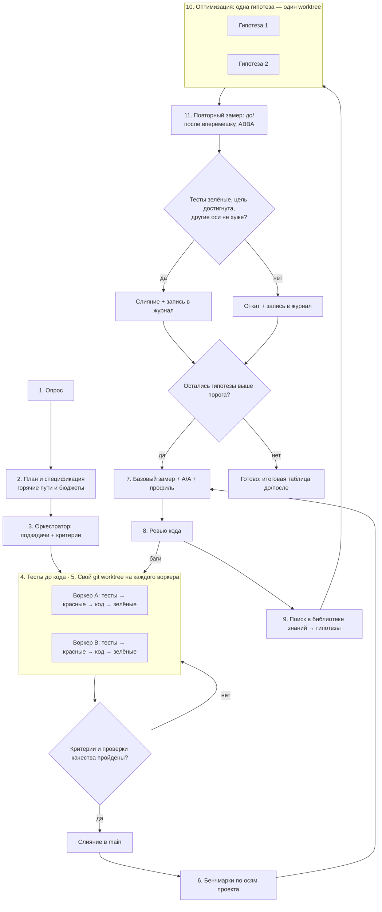

# Пайплайн разработки и оптимизации кода на TypeScript

Порядок работы над задачей на TypeScript: от постановки до кода с зелёными тестами, затем цикл оптимизации. После слияния в `main` пишутся бенчмарки, снимается базовый замер, проходит стандартное ревью, в библиотеке знаний ищутся решения для найденных проблем, каждое решение проверяется отдельно, и бенчмарки прогоняются снова. Правка оптимизации остаётся в `main`, только если замер подтвердил выигрыш. Пайплайн не зависит от предметной области и подходит для веб-приложений, библиотек, инструментов, мобильных и десктопных приложений, игр и визуализации.

Команды проверены на Windows 11 (Git Bash), Node 24.22, TypeScript 7.0.2, mitata 1.0.34, Lighthouse 13.6, size-limit 14.3, hyperfine 1.20 в ноябре 2026.

- [Схема](#схема)
- [Роли и модели](#роли-и-модели)
- [Этапы](#этапы)
- [Обязательные проверки качества](#обязательные-проверки-качества)
- [Этап 6. Бенчмарки](#этап-6-бенчмарки)
- [Этап 7. Базовый замер и профиль](#этап-7-базовый-замер-и-профиль)
- [Этап 8. Ревью кода](#этап-8-ревью-кода)
- [Этап 9. Поиск в библиотеке знаний](#этап-9-поиск-в-библиотеке-знаний)
- [Этапы 10–11. Оптимизация и повторный замер](#этапы-1011-оптимизация-и-повторный-замер)
- [Короткий режим](#короткий-режим)
- [Почему так](#почему-так)

## Схема



Если просмотрщик не рисует Mermaid:

```text
1. Опрос → 2. План и спека → 3. Оркестратор
                                  │
       ┌── git worktree на каждого воркера ──┐
       │ тесты → красные → код → зелёные     │
       └──────────────────┬──────────────────┘
                          ▼
         Критерии и проверки пройдены? да → main, нет → доработка
                          ▼
6. Бенчмарки → 7. Базовый замер, A/A, профиль → 8. Ревью (баги → этап 4)
                          ▼
         9. Поиск в библиотеке знаний → карточки гипотез
                          ▼
       ┌── одна гипотеза = один worktree ────┐
       │ 10. Правка, тесты и бенчмарки не менять │
       └──────────────────┬──────────────────┘
                          ▼
         11. Повторный замер ABBA и bench_compare
           выигрыш и нет регрессий → main + журнал
           иначе → откат + журнал
           остались гипотезы → снова с этапа 7
```

## Роли и модели

Пайплайн рассчитан на агента с субагентами. Если субагентов нет, один агент проходит те же этапы последовательно, а вместо worktree использует отдельные ветки.

| Роль | Рекомендуемая модель | Этапы |
| --- | --- | --- |
| Оркестратор: опрос, план, распределение работы, ревью, поиск решений, приёмка | Старшая модель, например Claude Opus 5.5 | 1–3, приёмка, 8, 9, решение на 11 |
| Воркер: основной код, тесты, бенчмарки, оптимизации | Средняя модель, например Claude Sonnet 5.5 | 4, 6, 10 |
| Рутина: простые правки, прогоны команд, сбор цифр | Быстрая модель, например Claude Haiku 5.5 | 4 (рутина), 7, 10 (простые правки), 11 (замер) |

Старшая модель только управляет и проверяет. Основной объём кода пишут более дешёвые модели.

## Этапы

| Этап | Модель | Что делает | Команда агенту |
| --- | --- | --- | --- |
| 1. Опрос | Opus 5.5 | Цель, ограничения, тип проекта, целевые браузеры и рантаймы, версия TypeScript, фреймворк, менеджер пакетов, зависимости, которые нельзя добавлять. Требования к скорости, памяти, размеру бандла, частоте кадров, времени проверки типов | «Прежде чем начать, задай мне вопросы по задаче» |
| 2. План и спецификация | Opus 5.5 | Фиксирует план и спеку файлом. Отдельно перечисляет горячие пути и бюджеты: что мерить, на какой оси, какой порог | «Составь план и спецификацию, отдельно перечисли горячие пути и бюджеты» |
| 3. Оркестратор | Opus 5.5 | Делит план на независимые подзадачи с критериями приёмки. Структуру и границы модулей сверяет с [architecture.md](architecture.md) | «Разбей план на подзадачи с критериями готовности» |
| 4. Тесты до кода | Sonnet 5.5, рутина — Haiku 5.5 | Пишет тесты по спеке, видит красные, пишет код и чинит до зелёных. Инструменты — [testing.md](testing.md) | «Сначала тесты по спеке, запусти — должны быть красными. Потом код, пока все не зелёные» |
| 5. Изоляция | git | Отдельный git worktree на каждого воркера. В каждом worktree свой `node_modules` | «Работай в отдельном worktree, main не трогай» |
| Приёмка | Opus 5.5 | Сверяет результат с критериями и [проверками качества](#обязательные-проверки-качества): слияние или возврат | «Проверь ветку по критериям и покажи вывод форматтера, линтера, тайпчекера и тестов» |
| 6. Бенчмарки | Sonnet 5.5 | Пишет бенчмарки на горячие пути из спеки по нужным осям. После этапа они заморожены | «Напиши бенчмарки на горячие пути из спеки по шаблону `scripts/bench_template.mts`, задай size-limit и замер типов» |
| 7. Базовый замер + профиль | Haiku 5.5 | A/A-проверка стенда, базовая линия в 5 прогонов, профиль самого медленного сценария | «Сними A/A, 5 прогонов в `bench/before/` и профиль самого медленного сценария. Сведи в таблицу» |
| 8. Ревью кода | Opus 5.5 | Стандартное ревью: баги, безопасность, типы, идиоматичность, архитектура | «Сделай ревью: баги отдельно, замечания по скорости и дизайну отдельно» |
| 9. Поиск в библиотеке знаний | Opus 5.5 | Сопоставляет профиль и замечания ревью с разделами справочников и пишет гипотезы | «По профилю и ревью найди решения в библиотеке знаний и оформи карточки гипотез» |
| 10. Оптимизация | Sonnet 5.5, простые правки — Haiku 5.5 | Каждая гипотеза реализуется отдельно, тесты и бенчмарки не меняются | «Реализуй гипотезу N в отдельном worktree, тесты и бенчмарки не трогай» |
| 11. Повторный замер | Haiku 5.5, решение — Opus 5.5 | Прогоняет бенчмарки «до» и «после» вперемешку и сравнивает скриптом, оркестратор решает: слить или откатить | «Сними по 5 чередующихся прогонов main и гипотезы и сравни скриптом bench_compare» |

## Обязательные проверки качества

Перед любым слиянием в `main`, и на приёмке, и на этапе 11, ветка проходит минимальный набор проверок. Порядок идёт от дешёвых проверок к дорогим. Подробности и шаблоны — в [toolchain.md → «Порядок проверок в CI»](toolchain.md#порядок-проверок-в-ci).

```bash
npm ci                                  # установка строго по lock-файлу
npx tsc -v                              # ожидаемая версия компилятора
npx prettier --check .                  # или oxfmt --check / biome ci — что принято в проекте
npx oxlint                              # или npx eslint --max-warnings=0 .
npx tsc --noEmit                        # проверка типов
npx vitest run --typecheck              # тесты и тесты типов; или раннер, принятый в проекте
npx knip                                # неиспользуемые файлы, экспорты, зависимости
npm run build                           # сборка: бандлер не проверяет типы
npm audit --omit=dev --audit-level=high # уязвимости в зависимостях рантайма
```

Ловушки:

- TypeScript 7 (пакет `typescript` с июля 2026) — компилятор на Go без программного API. Инструменты, которым он нужен, требуют TS 6 рядом. Такой alias занимает `node_modules/.bin/tsc`, и `npx tsc` молча запускает 6.0. Поэтому шаг `npx tsc -v` обязателен. Совместимость инструментов — [toolchain.md → «Статус компилятора»](toolchain.md#статус-компилятора).
- `vitest --typecheck` даёт ложный успех, если `typecheck.tsconfig` не включает файлы тестов ([testing.md → «Тесты типов»](testing.md#тесты-типов)).
- Бандлеры (Vite, esbuild, Rolldown) только стирают типы. Зелёная сборка ничего не говорит о типах.

По ситуации добавляются:

- `npx publint --strict` и `npx attw --pack .`, если это публикуемый пакет;
- `npx depcruise src`, если границы модулей закреплены правилами ([architecture.md → «Границы модулей»](architecture.md#границы-модулей)); убедитесь, что версия поддерживает ваш TypeScript и что в отчёте ненулевое число модулей;
- `npx stryker run` по изменённым модулям, если важна сила тестов ([testing.md](testing.md));
- проверки фреймворка: `vue-tsc --noEmit`, `svelte-check`, `ng build` ([frontend.md](frontend.md)).

Если проект на pnpm, Bun или Yarn, выполните те же шаги их командами. Если инструмента нет, скажите об этом и предложите команду установки из [toolchain.md](toolchain.md), а не пропускайте шаг молча.

## Этап 6. Бенчмарки

У TypeScript-проекта несколько независимых осей производительности, и оптимизация одной легко ухудшает другую. На этапе 2 спека называет оси, важные для проекта, на этапе 6 для каждой из них появляется замер.

| Ось | Когда нужна | Инструмент | Единица сравнения |
| --- | --- | --- | --- |
| Функции и алгоритмы | Есть вычисления, разбор данных, сериализация, шаг симуляции | mitata по [шаблону](../scripts/bench_template.mts); если поставить нельзя — [шаблон без зависимостей](../scripts/bench_template_nodeps.mts) | наносекунды на вызов |
| Загрузка страницы | Сайт или веб-приложение | Lighthouse (`--output=json`) | LCP, FCP, TBT, CLS, оценка |
| Отзывчивость | Интерактивный UI | Playwright + web-vitals и LoAF | INP, длинные задачи |
| Кадры | Игры, анимация, канвас, визуализация | сэмплер `requestAnimationFrame` | p50, p95, p99 времени кадра |
| Размер бандла | Всё, что доставляется по сети, и библиотеки | size-limit | байты после сжатия |
| Проверка типов | Большая кодовая база или сложные типы | `tsc --extendedDiagnostics` + [tsc_diag.mjs](../scripts/tsc_diag.mjs), hyperfine | `Instantiations`, время |
| Сборка | Долгий CI или dev-сервер | hyperfine | секунды |
| Мобильные и десктоп | Приложения на React Native, Tauri, Electron | Reassure, Flashlight, замер старта | см. [domains.md](domains.md) |
| Память | Долгоживущие приложения | heap snapshot, `performance.measureUserAgentSpecificMemory` | байты |
| Сервер на Node | HTTP-нагрузка | скилл node-knowledge | RPS, задержка |

Команды и форматы вывода — [benchmarking.md → «Метрика → инструмент → команда»](benchmarking.md#метрика--инструмент--команда).

- **Мерить то, что важно пользователю.** Горячие пути берутся из спеки, а не из догадок воркера.
- **Для функций явный прогрев обязателен.** V8 переводит функцию на оптимизирующий компилятор по числу выполнений, а не по времени. Без прогрева бенчмарк меряет медленный код, которого в продакшене нет. [Шаблон](../scripts/bench_template.mts) сначала делает 20 000 вызовов и только потом ждёт, пока время пачки стабилизируется.
- **Детерминизм.** Входные данные готовятся вне измеряемой функции, у генераторов случайных чисел фиксированный seed, данные реалистичны по размеру и форме. Результат передаётся в `do_not_optimize`, иначе V8 может выкинуть работу.
- **В браузере таймер грубый.** `performance.now()` без изоляции тикает с шагом 100 мкс, поэтому короткие функции меряются пачками (mitata из бандла) на странице с заголовками COOP и COEP. Vitest browser на коротких функциях выдаёт `p50 = 0`, и скрипт сравнения отклоняет такой файл ([benchmarking.md → «Микробенчмарки»](benchmarking.md#микробенчмарки)).
- **Имена стабильны.** У hyperfine задавайте `-n`, у size-limit — поле `name`. Иначе сравнивать будет нечего.
- **Бенчмарки замораживаются.** Как и тесты, они контракт. Если на этапе 10 бенчмарк изменится, сравнение с базовой линией потеряет смысл.

## Этап 7. Базовый замер и профиль

Сначала запишите окружение и проверьте стенд:

```bash
mkdir -p bench/before
{ node -p "process.version + ' V8 ' + process.versions.v8"; npx tsc -v; } > bench/before/env.txt
```

**A/A-проверка.** Снимите две серии прогонов на одном и том же коде и сравните их [скриптом](../scripts/bench_compare.mjs). Если он видит изменения или разброс больше порога приёмки, вердиктам на этой машине верить нельзя. Порог держите не ниже удвоенного измеренного шума.

**Базовая линия: пять прогонов в отдельных процессах.** Команда одного прогона зависит от оси:

| Ось | Команда одного прогона | Прогонов |
| --- | --- | --- |
| Функции | `node benchmarks/bench.mts > bench/before/run$i.json` | 5 |
| Страница | `npx lighthouse "$URL" --output=json --output-path="bench/before/run$i.json" --only-categories=performance --quiet --chrome-flags=--headless=new` | 5 |
| Размер бандла | `npx size-limit --json > bench/size-before.json` | 1, метрика детерминирована |
| Счётчики типов | `node node_modules/typescript/bin/tsc --noEmit --extendedDiagnostics --checkers 1 \| node <путь к скиллу>/scripts/tsc_diag.mjs > bench/types-before.json` | 1 |
| Время проверки типов | `hyperfine -N --warmup 1 --runs 10 -n tsc 'node node_modules/typescript/bin/tsc --noEmit' --export-json bench/tsc-before.json` | 10 внутри команды |

Флаг `--checkers` есть только в TypeScript 7; на TS 6 уберите его. С разным числом чекеров счётчик `Instantiations` меняется, поэтому для сравнения нужен один чекер.

- **Один прогон ничего не доказывает.** Каждый прогон — новый процесс со своим состоянием JIT и раскладкой памяти, и статистика внутри него этот шум не видит. Исключение — детерминированные метрики: байты и счётчики.
- **Пять прогонов, а не три.** При трёх прогонах на сторону одинаковый код случайно разделяется полностью с вероятностью 10%, при пяти — 0,8%.
- **Одинаковые условия.** Одна машина, одна версия Node и браузера, от сети, без другой тяжёлой работы, отладочные флаги выключены.
- **Счётчики TS 6 и TS 7 несравнимы.** `Types` на одном и том же проекте отличается в разы. Скрипт откажется их сравнивать, а время между поколениями компилятора сравнивайте через hyperfine.
- **Профиль самого медленного сценария.** CPU-профиль через DevTools или Playwright CDP, для Node `node --cpu-prof`, для типов `tsc --generateTrace`. Что доступно агенту без окна браузера — [benchmarking.md → «Профилирование»](benchmarking.md#профилирование).
- Итог этапа — таблица: сценарий, медиана, разброс между прогонами, топ горячих функций или типов.
- Если ревью на этапе 8 нашло баги и код после исправления поменялся, базовую линию нужно снять заново.

## Этап 8. Ревью кода

Ревью идёт до оптимизаций, потому что ускорять имеет смысл уже правильный код. Если у агента есть специализированные ревьюеры (TypeScript, React, Vue, безопасность), используйте их. Обязательный минимум — чеклисты:

- типы и идиоматичный код — [types-patterns.md → «Чеклист ревью типизации»](types-patterns.md#чеклист-ревью-типизации);
- тесты — [testing.md → «Чеклист ревью тестов»](testing.md#чеклист-ревью-тестов);
- UI — [frontend.md → «Чеклист ревью UI-кода»](frontend.md#чеклист-ревью-ui-кода);
- структура проекта — [architecture.md → «Чеклист ревью архитектуры»](architecture.md#чеклист-ревью-архитектуры).

Находки делятся на две группы:

- **баги** — неверное поведение, необработанные промисы, гонки, утечки слушателей и таймеров, небезопасные `as` и `any` на границах, данные без валидации, XSS, инъекции. Возвращаются на этап 4 с тестом, который воспроизводит баг;
- **можно сделать лучше** — скорость, память, размер бандла, сложность типов, дизайн. Идут на вход этапа 9.

## Этап 9. Поиск в библиотеке знаний

Оркестратор идёт от симптома к справочнику. Главная точка входа — таблица [performance.md → «Симптом → техника → источник»](performance.md#симптом--техника--источник).

| Что видно в профиле, замере или ревью | Куда смотреть |
| --- | --- |
| Горячая функция, полиморфный доступ к свойствам, деоптимизации | [performance.md → «Движки JS»](performance.md#движки-js) |
| Много аллокаций, медленные структуры данных, сортировка, строки, JSON | [performance.md → «Данные и алгоритмы»](performance.md#данные-и-алгоритмы) |
| Рост памяти, паузы GC, утечки, рывки кадров | [performance.md → «Память и GC»](performance.md#память-и-gc) |
| Лишний код от компилятора: `enum`, `target`, декораторы, `importHelpers` | [performance.md → «Что стоит слой TypeScript»](performance.md#что-стоит-слой-typescript) |
| Главный поток занят, CPU-задача, нужен Wasm | [performance.md → «Воркеры и Wasm»](performance.md#воркеры-и-wasm) |
| Плохие LCP, INP, CLS, длинные задачи | [performance.md → «Браузер и Core Web Vitals»](performance.md#браузер-и-core-web-vitals) |
| Большой бандл, плохой tree-shaking, дорогие зависимости | [performance.md → «Доставка JavaScript»](performance.md#доставка-javascript), [architecture.md → «Barrel-файлы»](architecture.md#barrel-файлы) |
| Лишние рендеры, проблемы конкретного фреймворка | [frontend.md](frontend.md), раздел фреймворка |
| Состояние и серверные данные | [frontend.md → «Состояние и серверные данные»](frontend.md#состояние-и-серверные-данные) |
| Проверка типов медленная, много инстанцирований | [toolchain.md → «Диагностика медленной проверки типов»](toolchain.md#диагностика-медленной-проверки-типов), [types-patterns.md → «Стоимость типов при компиляции»](types-patterns.md#стоимость-типов-при-компиляции) |
| Медленная сборка, линт, dev-сервер | [toolchain.md → «Сборщики и транспиляторы»](toolchain.md#сборщики-и-транспиляторы), [«Линтеры и форматтеры»](toolchain.md#линтеры-и-форматтеры) |
| Неудобные типы, `any`, небезопасные границы, ошибки | [types-patterns.md → «Мини-каталог паттернов»](types-patterns.md#мини-каталог-паттернов), [«Антипаттерны»](types-patterns.md#антипаттерны) |
| Запутанные зависимости, циклы импортов, долгие пересборки монорепозитория | [architecture.md → «Границы модулей»](architecture.md#границы-модулей), [«Монорепозитории»](architecture.md#монорепозитории) |
| Проблема типична для домена: мобильные, десктоп, игры, визуализация, edge, AI | [domains.md](domains.md), раздел домена |
| Популярный совет вызывает сомнение | [performance.md → «Мифы об оптимизации»](performance.md#мифы-об-оптимизации) |
| Нужно глубже разобраться в теме | [books.md](books.md) |

Результат этапа — список карточек гипотез, отсортированный по ожидаемому эффекту:

```text
Гипотеза N: <что меняем>
Где: <файл и функция, тип или модуль>
Почему: <горячее место из профиля, цифра замера или замечание ревью>
Источник: <ссылка из библиотеки знаний>
Цель: <ось и бенчмарк, насколько должно улучшиться>
Побочные оси: <что может ухудшиться: бандл, типы, память, читаемость>
Риск: <что может сломаться, нужна ли новая зависимость, совместимость с целевыми браузерами и рантаймами>
```

Если в библиотеке нет решения под найденную проблему, это пишется в карточке прямо, без выдуманного решения. Такой пробел — повод дополнить библиотеку. Гипотезы, уже отклонённые в журнале, повторно не проверяются.

## Этапы 10–11. Оптимизация и повторный замер

Каждая гипотеза реализуется в своём worktree, чтобы эффект был виден отдельно. Для решения базовая линия снимается заново, вперемешку с прогонами гипотезы. Старая линия из этапа 7 для этого не годится: за время работы состояние машины меняется, и дрейф легко принять за ускорение. Порядок внутри пары меняется (ABBA), потому что прогон сразу после другого варианта бывает систематически быстрее или медленнее.

```bash
# ../wt-main — worktree с main, ../wt-hyp — worktree с гипотезой; в обоих выполнены npm ci и сборка
SKILL="<путь к скиллу>"
OUT="$PWD/bench"; mkdir -p "$OUT/before" "$OUT/after"

measure() {  # $1 — worktree, $2 — файл результата; тело заменяется под ось
  (cd "$1" && node benchmarks/bench.mts) > "$2"
}

for i in 1 2 3 4 5; do
  if [ $((i % 2)) = 1 ]; then
    measure ../wt-main "$OUT/before/run$i.json"
    measure ../wt-hyp  "$OUT/after/run$i.json"
  else
    measure ../wt-hyp  "$OUT/after/run$i.json"
    measure ../wt-main "$OUT/before/run$i.json"
  fi
done

node "$SKILL/scripts/bench_compare.mjs" "$OUT/before" "$OUT/after" --threshold 5
```

На Windows цикл работает в Git Bash. Для других осей меняется тело `measure` по таблице из [этапа 7](#этап-7-базовый-замер-и-профиль). Для страницы соберите каждый worktree и поднимите его на своём порту: скрипт сравнивает страницы по пути, поэтому порт на результат не влияет. Размер бандла и счётчики типов детерминированы, для них достаточно одного прогона на сторону.

[bench_compare.mjs](../scripts/bench_compare.mjs) — однофайловый скрипт без зависимостей для Node 18+. Он принимает JSON одного прогона или папку прогонов и сам определяет формат: mitata, Vitest 5, hyperfine, Lighthouse, size-limit, tachometer или общий формат. Для каждого бенчмарка скрипт печатает медианы, изменение и вердикт:

- `faster` и `slower` для времени, `better` и `worse` для остальных метрик, `same` — в пределах шума;
- при 2–7 прогонах на сторону вердикт ставится, только если медиана сдвинулась больше порога и прогоны двух сторон полностью разделились, при 5+5 это точный тест Манна-Уитни с p = 0,0079; от 8 прогонов считается U-тест с p < 0,01;
- код выхода 1 — регрессия, упавший или пропавший бенчмарк; 2 — ошибка ввода, в том числе `median = 0` от грубого таймера и сравнение счётчиков разных поколений компилятора.

Гипотеза сливается в `main`, только если выполнены все условия:

1. Все [проверки качества](#обязательные-проверки-качества) пройдены, тесты зелёные.
2. У целевого бенчмарка вердикт `faster` или `better`, а выигрыш не меньше порога из спеки. Порог по умолчанию — 5%, для микробенчмарков короче нескольких микросекунд — 10%.
3. **Остальные оси не ухудшились.** Скрипт не показывает `slower` и `worse` ни на одной оси из спеки. Ускорение функции ценой роста бандла или времени проверки типов принимается, только если компромисс явно разрешён спекой.
4. Код не стал заметно хуже: оркестратор коротко проверяет правку. Каждая новая зависимость и каждый `as` или `any` оправданы выигрышем.

Иначе worktree удаляется. В обоих случаях результат записывается в журнал оптимизаций, например `docs/perf-log.md`:

| Гипотеза | Источник | Ось | До | После | Решение |
| --- | --- | --- | --- | --- | --- |
| `Array.includes` → `Set.has` в `filterKnown` | ссылка из библиотеки | функции | 1,82 мс | 0,41 мс | слита |
| Убрать barrel-файл в `ui/index.ts` | ссылка из библиотеки | бандл | 184 кБ | 171 кБ | слита |
| Заменить условный тип на перегрузки в `Query<T>` | ссылка из библиотеки | типы | 1,2 млн | 1,19 млн | отклонена, ниже порога |

Журнал не даёт повторно проверять отклонённые идеи. Если гипотезы сливались, следующий круг начинается с нового `main`. Цикл 7–11 повторяется, пока остаются гипотезы с ожидаемым эффектом выше порога. В конце цикла сравните первую базовую линию с итоговым `main` и покажите таблицу «до и после» по всем осям.

Затем уберите за собой: `git worktree remove <путь>` для каждого worktree цикла и `git branch -d` для слитых веток. Ветку отклонённой гипотезы удаляйте через `git branch -D`, только когда результат уже записан в журнал.

## Короткий режим

Для небольшой задачи (одна функция, один баг) весь пайплайн избыточен. Достаточно:

1. Тест, который воспроизводит задачу.
2. Код до зелёного теста.
3. [Проверки качества](#обязательные-проверки-качества).
4. Ревью по чеклисту из [types-patterns.md](types-patterns.md#чеклист-ревью-типизации).

Цикл оптимизации запускается, только если в задаче есть требование к скорости, размеру или памяти либо замер показал проблему.

## Почему так

- **Тесты — это контракт.** Если тесты написаны до кода, агент не подгонит их под уже сделанное. Фраза «готово, всё работает» без зелёного прогона ничего не значит.
- **Бенчмарки — тоже контракт.** Их пишут до оптимизаций и не трогают, поэтому «стало быстрее» подтверждается цифрами, а не ощущением.
- **Осей несколько.** В TypeScript скорость выполнения, размер бандла и стоимость типов часто тянут в разные стороны, поэтому каждая правка проверяется по всем осям спеки.
- **Шум измеряется, а не предполагается.** A/A показывает, чему можно верить на этой машине, а чередующиеся прогоны гасят дрейф и эффект порядка.
- **Сначала корректность, потом скорость.** Ревью стоит до оптимизаций, и ускорять приходится уже правильный код.
- **Решения берутся из источников.** Каждая гипотеза ссылается на материал из библиотеки. Это отсекает выдуманные «оптимизации» и сразу даёт материал для разбора.
- **Одна гипотеза — один worktree.** Эффект каждой правки виден отдельно, и неудачную легко откатить, не задев удачные.
- **Worktree защищает main.** Параллельные воркеры не мешают друг другу и не ломают основную ветку.
